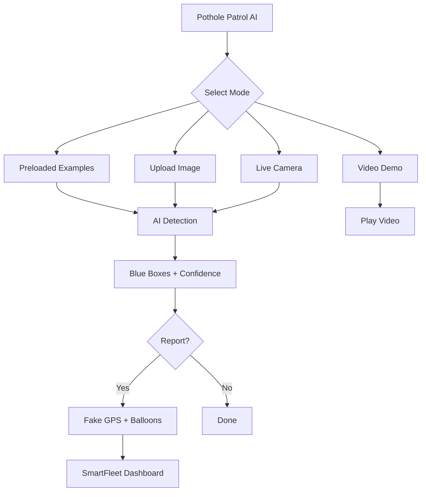

# Pothole Patrol AI
**Pothole detection on road photos, camera snapshots and a demo video, running in the browser**


**Live App (mobile camera works):** [https://pothole-patrol-ai.com](https://pothole-patrol-ai.com)

---

## Overview

**Pothole Patrol AI** is a computer vision web app that uses a **YOLOv8 model exported to ONNX** to find potholes. It has four input modes:

- **Preloaded examples** — Try 5 built-in pothole samples  
- **Upload your own image** — Drag and drop any road photo  
- **Phone camera** — Snap a photo of the road and run detection on it  
- **Video demo** — Watch AI analyze real driving footage  

It is a portfolio demo aimed at fleet and city use cases. The "Report to SmartFleet" button is a simulation: it shows a fake Chicago location and sends nothing.

---

## Key Features

### 1. Preloaded Examples  
Try 5 sample images with no setup. (The `Example Photos/` folder is not in this repo yet, so a local run shows "not found" here.)


---

### 2. Upload Your Own Photo  
Drag and drop a road image; the model draws a box and confidence score on each pothole it finds.


---

### 3. Camera Detection  
Take a photo with your phone or webcam (Streamlit `camera_input`) and the model detects potholes in the snapshot.


 
---

### 4. Report to SmartFleet (Demo)  
Tap **Report To SmartFleet**: a demo step that shows a randomly chosen (fake) Chicago location. Nothing is actually sent.


---

### 5. Video Demo  
Play a pre-recorded driving clip with pothole detections.


---

## Tech Stack

| Technology | Purpose |
|------------|---------|
| **YOLOv8 (ONNX)** | Pothole detection model (640×640 input, confidence threshold 0.4, NMS) |
| **ONNX Runtime** | Lightweight inference engine |
| **Streamlit** | Interactive web frontend |
| **OpenCV** | Image preprocessing & bounding box rendering |
| **AWS Lightsail** | Demo hosting |
| **Python 3.9+** | Core language |

## Model and results

- Detector: YOLOv8 exported to ONNX (`Model/pothole-model.onnx`; the PyTorch weights are `Model/pothole-model.pt`)
- Inference runs on CPU with ONNX Runtime; boxes above 0.4 confidence are kept after non-max suppression
- Training data and evaluation metrics (e.g. mAP) are **not included in this repo yet**, so no accuracy figures are claimed here. The demo video and sample detections show the model's behaviour qualitatively.

---

## Architecture



At runtime: Streamlit page → image resized to 640×640 → ONNX Runtime runs `pothole-model.onnx` on CPU → boxes above 0.4 confidence kept after NMS (IoU 0.45) → OpenCV draws them. The live app is hosted on AWS Lightsail and served over HTTPS at pothole-patrol-ai.com.

---
## Try the Demo

**Live App (mobile camera works):** [https://pothole-patrol-ai.com](https://pothole-patrol-ai.com)

> **No login. Photos are not saved.**  

---

## Project Structure

```
app.py                      # Streamlit app (ONNX inference, upload / camera / examples / video)
requirements.txt
Model/pothole-model.onnx    # YOLOv8 model exported to ONNX (used by the app)
Model/pothole-model.pt      # YOLOv8 PyTorch weights
Demo Video/pothole_demo.mp4 # demo driving clip
README.md
```

## Run Locally

```bash
pip install -r requirements.txt onnxruntime
cp Model/pothole-model.onnx .          # app.py loads pothole-model.onnx from the working directory
streamlit run app.py
```

Notes: the app looks for sample images in an `Example Photos/` folder (pothole1.jpg … pothole5.jpg) and the video at `Demo-Videos/pothole_demo_h264.mp4`; those paths aren't in this repo yet, so the examples and video sections show a "not found" message until you add them. `onnxruntime` is imported by `app.py` but not yet listed in `requirements.txt`.

---

## Deployment (AWS Lightsail)

1. Launch **Ubuntu 22.04** instance  
2. Install Python + Streamlit  
3. Copy files via `scp`  
4. Run: `nohup streamlit run app.py --server.port=8501 &`  
5. Open port `8501` in firewall  

---

## Privacy & Demo Mode

> **This is a demo.**  
> - Photos are **not saved**  
> - GPS is **fake** (Chicago neighborhoods)  
> - No user data collected  

---

Built by Ron Lance, [Alpha Peak Technologies](https://alphapeaktech.com) · [LinkedIn](https://www.linkedin.com/in/ron-lance-49aa2a8/)
